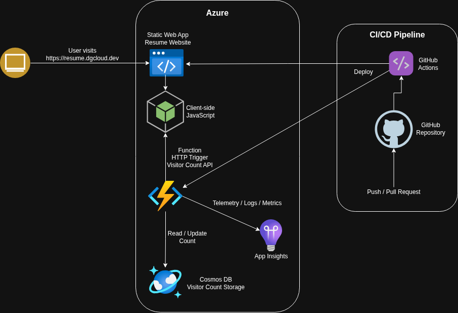

## Architecture

This project implements the Cloud Resume Challenge using a serverless architecture on Microsoft Azure. The resume website is hosted in Azure Static Web Apps, with a visitor counter powered by Azure Functions and Azure Cosmos DB. Source code is maintained in GitHub and automatically deployed through GitHub Actions. Azure Application Insights provides monitoring and telemetry for the serverless components. The solution demonstrates cloud hosting, serverless computing, NoSQL data storage, CI/CD automation, and observability in a production-style deployment. 

### Architecture Diagram

### Cloud Operations Extension

In addition to the core Cloud Resume application, this project includes a complete operational monitoring solution built with Azure Monitor, Log Analytics, Workbooks, Dashboards, Availability Tests, and Alerting. The solution provides centralized observability across the platform. 

➡️ docs/cloud-ops/README.md

### Architecture Overview

This solution follows a serverless architecture pattern. Azure Static Web Apps hosts the frontend, Azure Functions provides the API layer, Azure Cosmos DB stores visitor count data, GitHub Actions automates deployments, and Azure Application Insights provides monitoring and telemetry. 

### Solution Components

| Component | Purpose |
|------------|----------|
| Azure Static Web Apps | Hosts the resume website and frontend assets |
| Client-side JavaScript | Calls the visitor counter API and updates the webpage |
| Azure Functions | Provides the serverless API used by the visitor counter |
| Azure Cosmos DB | Stores and updates visitor count data |
| Azure Application Insights | Collects telemetry, logs, and performance metrics |
| GitHub Repository | Stores application source code |
| GitHub Actions | Automates build and deployment workflows |

### Request Flow

1. A user visits the resume website hosted in Azure Static Web Apps. 
2. Client-side JavaScript sends an HTTPS request to the visitor counter API. 
3. An Azure Function receives the request, retrieves the current visitor count from Azure Cosmos DB, increments the count, and returns the updated value to the website. 
4. The updated visitor count is displayed on the webpage. 
5. Application telemetry, logs, and performance data are sent to Azure Application Insights for monitoring and troubleshooting. 

### CI/CD Workflow

1. Changes are committed and pushed to the GitHub repository. 
2. GitHub Actions automatically executes the deployment workflow. 
3. GitHub Actions builds and deploys the application components to Azure. 
4. The latest version of the application becomes available without manual deployment steps. 

### Technologies Used

- Azure Static Web Apps
- Azure Functions
- Azure Cosmos DB
- Azure Application Insights
- GitHub Actions
- GitHub
- HTML
- CSS
- JavaScript 

### Design Goals

- Implement a serverless architecture with minimal operational overhead
- Automate deployments through CI/CD
- Build a scalable visitor counter solution
- Enable cloud-native monitoring and diagnostics
- Demonstrate practical Azure skills across hosting, serverless compute, data storage, monitoring, and CI/CD workflows 