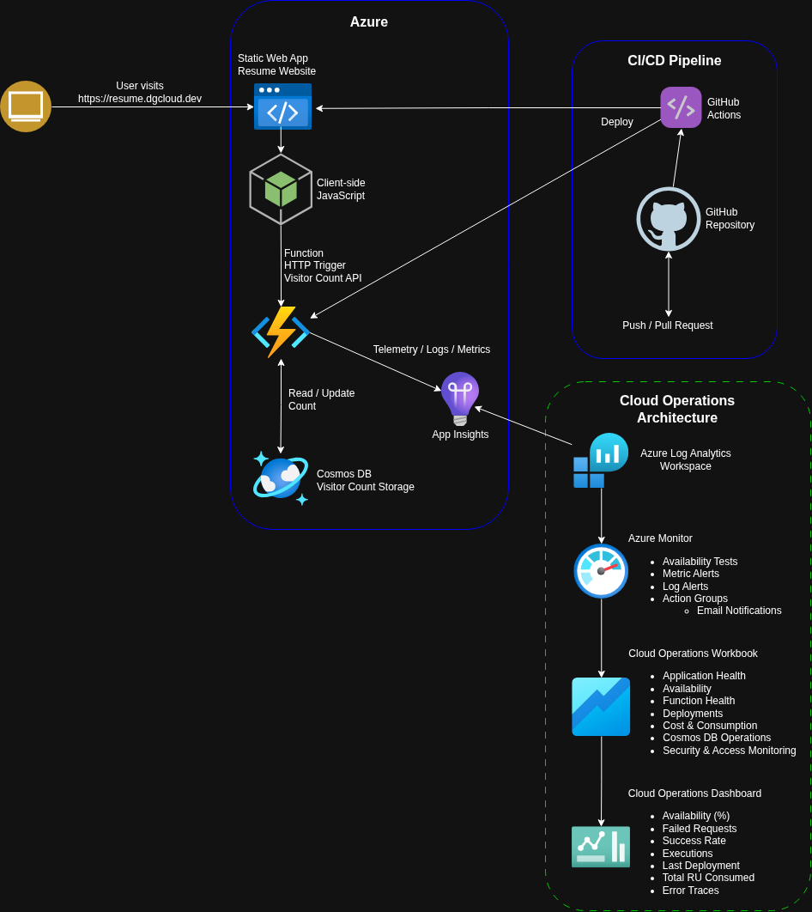
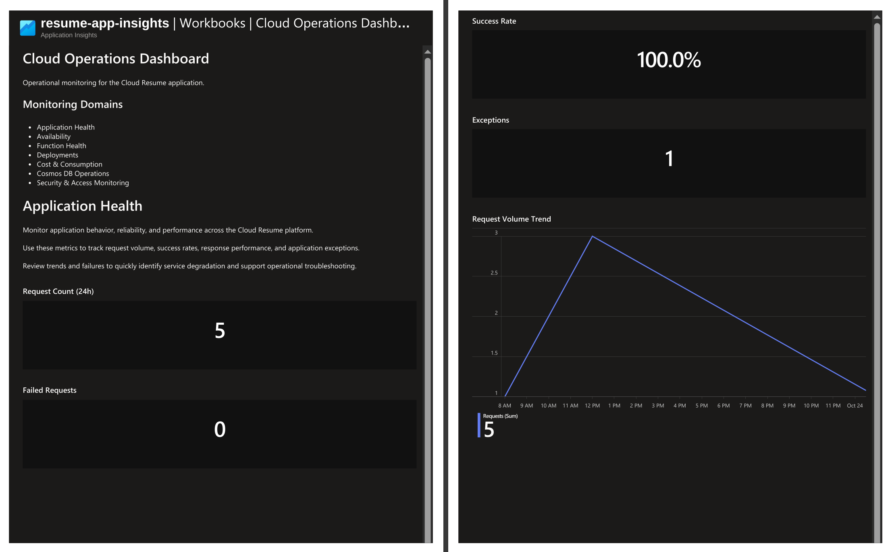
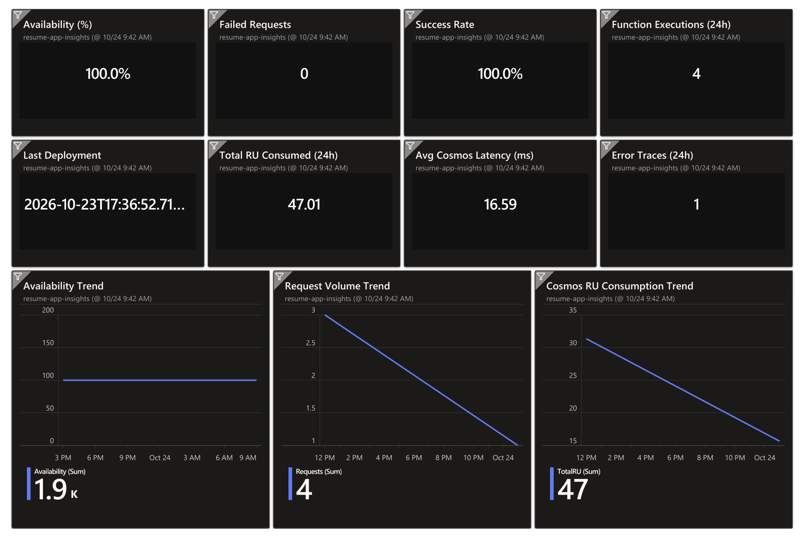
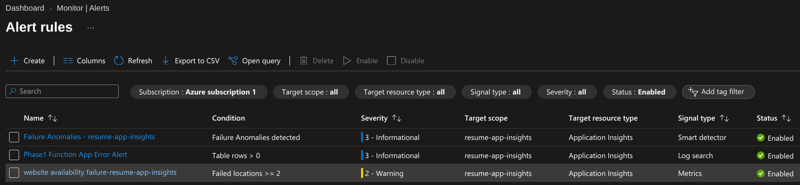
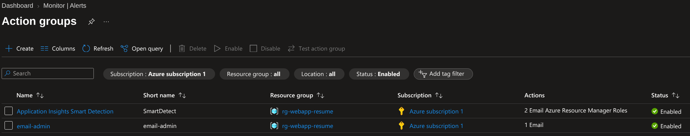

Part of the Cloud Resume Challenge project.

⬅️ Return to the main project: ../../README.md

# Cloud Operations Dashboard

## Overview

The Cloud Operations Dashboard extends the Cloud Resume solution by providing centralized operational visibility, monitoring, alerting, and observability across the platform. It enables proactive detection of issues, performance monitoring, deployment tracking, and consumption analysis using native Azure monitoring services.

---

## Cloud Operations Architecture

### Architecture Diagram

The solution combines application hosting, monitoring, logging, alerting, and visualization into a single operational workflow. Telemetry generated by the application stack is collected, analyzed, and surfaced through Azure Monitor, dashboards, and workbooks to provide operational visibility and proactive issue detection.

---

## Architecture Components

### Cloud Resume Base Platform

The Cloud Operations Dashboard extends the Cloud Resume application, which consists of:

- Azure Static Web App
- Azure Functions
- Azure Cosmos DB
- GitHub Actions
- Azure Application Insights

### Cloud Operations Components

The following components were added to extend the Cloud Resume platform with monitoring, alerting, and operational observability.

| Component | Purpose |
|------------|---------|
| Log Analytics Workspace | Centralizes telemetry and operational log data |
| Azure Monitor | Correlates metrics, logs, and health signals |
| Availability Tests | Validates endpoint availability and responsiveness |
| Alert Rules | Detects failures and abnormal conditions |
| Action Groups | Delivers operational notifications |
| Cloud Operations Workbook | Provides detailed operational reporting and analysis |
| Cloud Operations Dashboard | Surfaces key operational KPIs and health metrics |

---

## Monitoring Domains

The dashboard is organized to address key operational concerns: 

- Application Health
- Availability
- Function Health
- Deployments
- Cost & Consumption
- Cosmos DB Operations
- Security & Access Monitoring

---

## Operational Artifacts

### Cloud Operations Workbook

The Cloud Operations Workbook provides detailed operational reporting across:

- Application Health
- Function Health
- Deployments
- Cost & Consumption
- Cosmos DB Operations
- Security & Access Monitoring

---

### Cloud Operations Dashboard

Provides a summarized operational view of platform health, availability, deployments, performance, and database consumption. Key metrics include:

- Availability (%)
- Failed Requests
- Success Rate
- Function Executions
- Last Deployment
- Total RU Consumed
- Error Traces
- Performance Trends

---

### Alerting Configuration

Azure Monitor alert rules continuously evaluate telemetry and exception data to identify operational issues and generate notifications through Action Groups. 

---

## Operational Flow

1. Application telemetry is generated by the Static Web App, Azure Functions, and Cosmos DB.
2. Application Insights collects metrics, traces, requests, and exception data.
3. Log Analytics centralizes operational data.
4. Azure Monitor evaluates health signals and alert rules.
5. Cloud Operations Workbooks visualize operational details.
6. Dashboards provide high-level operational visibility.
7. Action Groups notify operators when alert conditions are met. 

---

## Outcome

This Cloud Operations implementation delivers end-to-end observability for the platform by combining monitoring, dashboards, alerting, deployment tracking, availability testing, and cost analysis into a single operational framework.